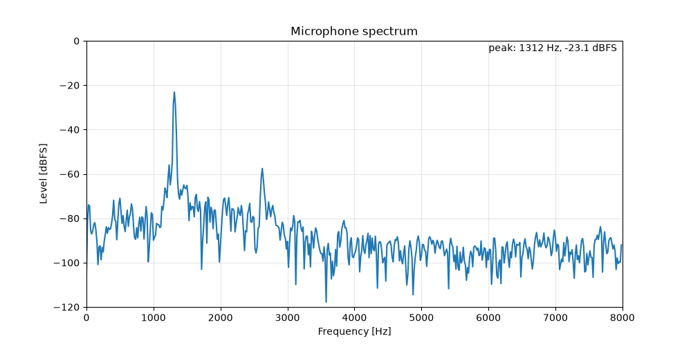

# RTOS Audio Processing - STM32F411E-DISCO

Real-time audio processing on the **STM32F411E-DISCO** board with **FreeRTOS**.

The on-board MEMS microphone (MP45DT02) is sampled in **PDM** format and converted to **PCM** (16 kHz, 16-bit). The audio is played back through the on-board **CS43L22** codec (headphone jack) and, in parallel, analysed with a **1024-point FFT** using a **Hann window**. The spectrum (**0–8 kHz**, half of the sampling rate) is sent over **UART** to a PC, where a Python app displays it live.

To keep audio continuous, all data transfers use **DMA** (I2S microphone input, I2S codec output in ping-pong mode, UART output). Tasks are synchronised with **semaphores** and **message queues**, and an **IWDG watchdog** supervised through an **event group** resets the MCU if any task stops responding.

## FFT parameters

| Parameter | Value |
|---|---|
| Sampling rate | 16 kHz |
| FFT size | 1024 points (CMSIS-DSP library `arm_rfft_fast_f32`) |
| Window | Hann |
| Frequency range | 0 – 8 kHz |
| Resolution | 15.6 Hz per bin |
| Update rate | every 64 ms (~15.6 spectra/s) |
| Output | 512 magnitudes, float32, sent over UART at 921600 baud |

## Synchronisation and safety mechanisms

| Mechanism | Used for |
|---|---|
| **DMA, circular buffer (ping-pong halves)** | microphone input (I2S2), half/complete interrupts signal which half holds new data |
| **DMA, circular buffer (ping-pong halves)** | codec output (I2S3), each half is refilled only after it has been played |
| **DMA, single transfer** | UART frame (sync word + spectrum) to the PC |
| **Binary semaphore** | DMA interrupt wakes the audio task when a PDM block is ready |
| **Message queues** | each consumer (codec output, FFT) gets its own copy of the PCM block |
| **Binary semaphore (UART)** | a new frame is sent only after the previous DMA transfer finishes |
| **Event group + IWDG watchdog** | every task checks in; the supervisor refreshes the watchdog only if all tasks are alive, otherwise the MCU resets (~1 s) |

## Quick start

1. Clone and open the project in **STM32CubeIDE**, open `RTOS_audio.ioc` and click **Generate Code** (restores HAL and FreeRTOS).
2. Build and flash (*Run As → STM32 C/C++ Application*).
3. Connect a 3.3 V USB-UART adapter (tested with **Prolific PL2303**, appears as `/dev/ttyUSB0` on Linux): **PA2 → RX**, **PA3 → TX**, **GND → GND** (921600 baud, 8N1).
4. Run the viewer (set `PORT` in `fft_viewer.py` first):
   ```bash
   cd tools/fft_viewer
   pip install -r requirements.txt
   python fft_viewer.py
   ```
5. Try to whistle :) - peak at 1300 Hz ~ 83 bin 

